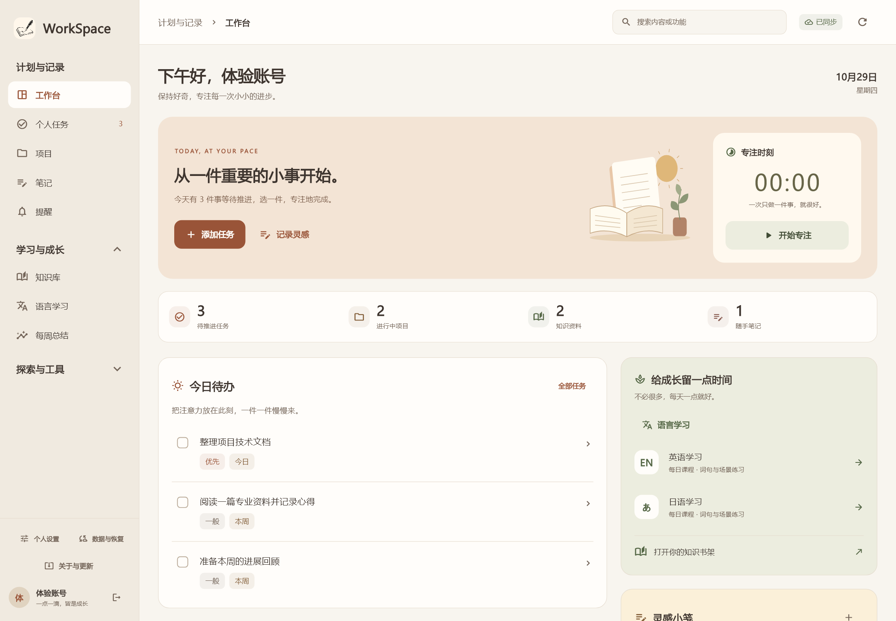
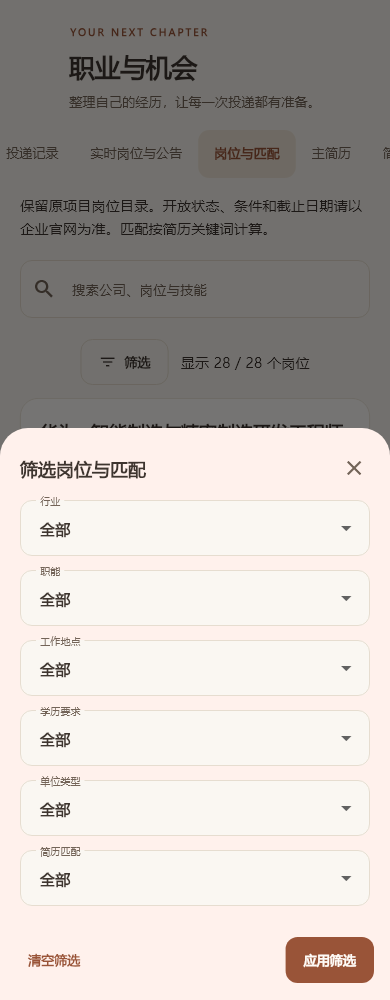
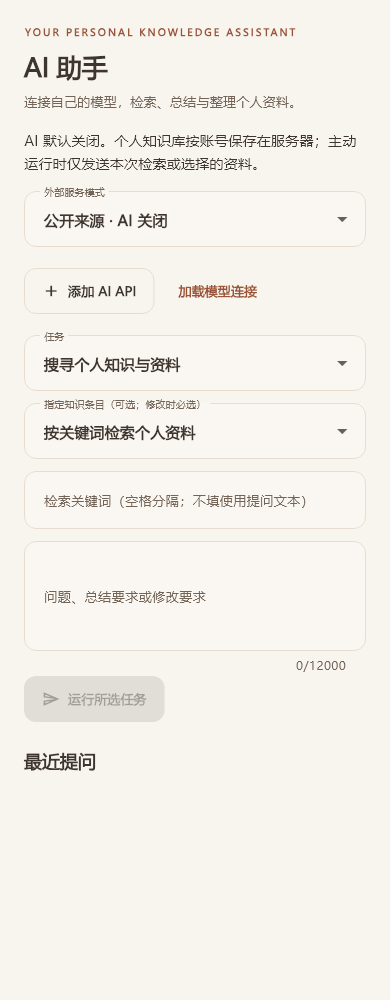
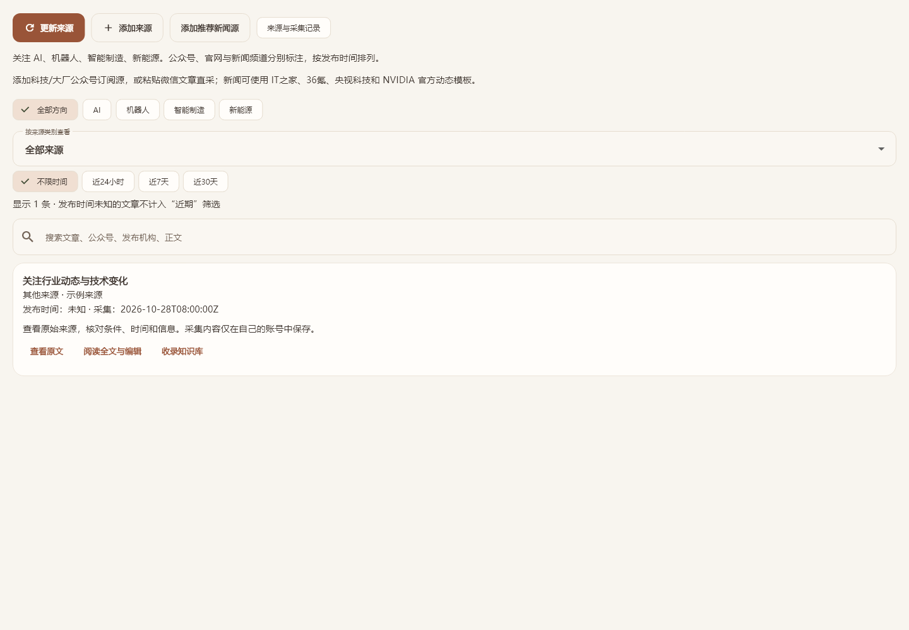

# WorkSpace · Personal Workspace

**[简体中文](README.md) · English**

Bring tasks, knowledge, learning and industry information into a workspace of your own.

A personal workspace for Windows and Android: tasks, private knowledge, language learning, job tracking, market research and optional AI assistance. Built with Flutter and Supabase.

[](https://github.com/Z-FLY-FADED/atlas-personal-workbench/releases)
[](https://github.com/Z-FLY-FADED/atlas-personal-workbench/actions/workflows/native-app.yml)
[](docs/download-and-use.md)
[](apps/atlas)
[](supabase)

**[Download the 0.6.0 public preview](https://github.com/Z-FLY-FADED/atlas-personal-workbench/releases/tag/v0.6.0)** · [User guide](docs/download-and-use.md) · [Release notes](docs/release-0.6.0.md) · [Report an issue](https://github.com/Z-FLY-FADED/atlas-personal-workbench/issues/new/choose)

The current app interface is primarily Chinese. Linked documentation is currently in Chinese unless stated otherwise.



## What you can do

| Use case | Features |
| --- | --- |
| Planning and notes | Today dashboard, tasks, projects, notes, reminders, focus sessions and weekly reviews |
| Private knowledge library | Save article text, sources and related materials; read practical guides and turn collected information into personal knowledge |
| Language learning | English and Japanese lessons, vocabulary, sentences and situational practice |
| Job applications | Master resume, resume versions, application records, job catalog and keyword matching; combine filters for status, company, location, education and more |
| Stock research | Mainland China A-share, Hong Kong and US stock catalogs and watchlist groups; filter by market, industry, risk, quote availability, price movement and price; Jin10 financial news |
| Industry overview | Follow AI, robotics, smart manufacturing and new energy; distinguish technology and corporate WeChat accounts, news channels, media outlets and official websites |
| Personal AI | Add Chat Completions compatible APIs and models; search the current account's materials, summarize content, and preview and confirm changes to knowledge entries |
| Windows, Android and updates | Use the same account on both platforms; server data is isolated by account; sync and create an encrypted local backup before updates |

AI is off by default. Public-source collection and rule-based filtering do not require a model. Personal knowledge, sources and AI records are stored on the server. Model API keys are encrypted server-side, and clients cannot read the key table. Data access and writes are constrained by Supabase Auth, row-level security (RLS) and revision checks. See [architecture and deployment](docs/native-app.md) and [exploration and AI](docs/exploration-and-ai.md).

## What's new in 0.6.0

- **More detailed filters:** Application records, jobs and matching, stock catalogs and watchlists support combined filters alongside existing search and quick tags. [Filter rules](docs/list-filters.md)
- **Traceable information sources:** Adapters for RSS, Atom, JSON Feed, public web announcements, JobPosting data, Jin10 and CCTV technology news record original content, publication times, collection results and failure reasons.
- **Separate WeChat source categories:** Extract individual publicly readable WeChat articles and connect authorized subscription feeds; filter by topic, category and recency. [Source guide](docs/industry-sources.md)
- **Bring your own AI API:** Configure multiple API connections, search account-scoped materials, summarize content and preview edits. Saving a confirmed edit checks the material's revision to avoid overwriting newer changes from another device.

Collection starts when the user clicks “Update sources”; there is currently no scheduled background collection. Website login requirements, verification challenges, anti-scraping measures and service timeouts can affect availability. A single WeChat article URL does not discover new posts automatically; continuous updates require a subscription service you have authorized. Live WeChat tests that returned verification pages were recorded as failures. **Continuous collection of the latest WeChat public-account posts has not yet been connected.** A recruitment source link does not confirm that a position is still open. Stock prices are shown in their original currencies.

## Screenshots

Screenshots use isolated test data and show desktop and mobile layouts.

| Combined job filters | Personal AI APIs and material operations |
| --- | --- |
|  |  |



## Download and get started

Choose an installer from the Assets section of [Releases](https://github.com/Z-FLY-FADED/atlas-personal-workbench/releases/tag/v0.6.0). You do not need to compile the source code to use the app.

| Platform | Download and run |
| --- | --- |
| Windows 10 / 11 x64 | Download the [complete ZIP](https://github.com/Z-FLY-FADED/atlas-personal-workbench/releases/download/v0.6.0/WorkSpace-0.6.0-Windows-x64.zip), extract it and run `WorkSpace.exe`. Keep the DLL files and `data/` directory alongside the executable. |
| Android | Download the [signed APK](https://github.com/Z-FLY-FADED/atlas-personal-workbench/releases/download/v0.6.0/WorkSpace-0.6.0-Android.apk) and install it through the system installer. Install over the existing app when upgrading. |

Create your own username and password on first use. Sign in with the same account on both devices to access the same cloud workspace. Registration, sign-in and server storage require an internet connection. Public release packages connect to a maintainer-hosted Supabase project; self-hosted deployments can configure their own project. Existing 0.5.2 users can check for a new version in “About and updates”. Updates first sync data and create an encrypted local backup; keeping a separate export is still recommended. [Updates and data protection](docs/app-updates.md)

This is a public preview. The Windows app has no commercial code signature. Android upgrades on physical devices and synchronization between two devices have not yet completed live testing. The release page includes a file checksum manifest. See the [0.6.0 release notes](docs/release-0.6.0.md) for the detailed scope.

## Run from source

The main app uses Flutter and Dart. The backend uses Supabase PostgreSQL, Realtime and Edge Functions. Install Flutter and the toolchain for your target platform. Copy `apps/atlas/config/example.json` to `dev.json` in the same directory, then enter your own Supabase URL and **Publishable Key**. For database migrations, functions and server-side secrets, see the [native app guide](docs/native-app.md) and [exploration and AI deployment](docs/exploration-and-ai.md).

```powershell
powershell -ExecutionPolicy Bypass -File scripts/flutter-app.ps1 -Action get
powershell -ExecutionPolicy Bypass -File scripts/flutter-app.ps1 -Action analyze
powershell -ExecutionPolicy Bypass -File scripts/flutter-app.ps1 -Action test
powershell -ExecutionPolicy Bypass -File scripts/flutter-app.ps1 -Action run-windows -Config dev
```

For Android, use `-Action run-android -Device <device-id>`. Release builds use `-Action build-windows -Config prod` and `-Action build-apk -Config prod`; APK builds require a persistent local signing key. Do not commit server-side secrets, model API keys, signing files or personal data to the repository.

```text
apps/atlas/        Main Flutter app for Windows and Android
supabase/         Migrations, account isolation, collection and AI functions, server tests
scripts/          Development, build, signing checks and public update manifests
updates/          Public version manifests read by installed apps
docs/             Usage, deployment, release notes and screenshots
app/ + desktop/   Retained legacy React / Electron app
```

Legacy development commands and the D1 architecture are documented in the [legacy workspace guide](docs/legacy-web.md).

## Contributing and feedback

Report problems and specific use cases through [Issues](https://github.com/Z-FLY-FADED/atlas-personal-workbench/issues), or read the [contribution guide](CONTRIBUTING.md) before submitting a pull request. Include the app version, platform and reproduction steps, and remove personal information and secrets. If the project is useful to you, consider starring it or sharing the project link.

The source-adapter and retrieval organization draws design inspiration from [RSSHub](https://github.com/DIYgod/RSSHub), [Scrapy](https://github.com/scrapy/scrapy), [AKShare](https://github.com/akfamily/akshare) and [Dify](https://github.com/langgenius/dify); this repository implements its own lightweight workflows. Authorized WeChat subscriptions can connect to standalone services such as [WeWe RSS](https://github.com/cooderl/wewe-rss). These platforms are not bundled into the client.
