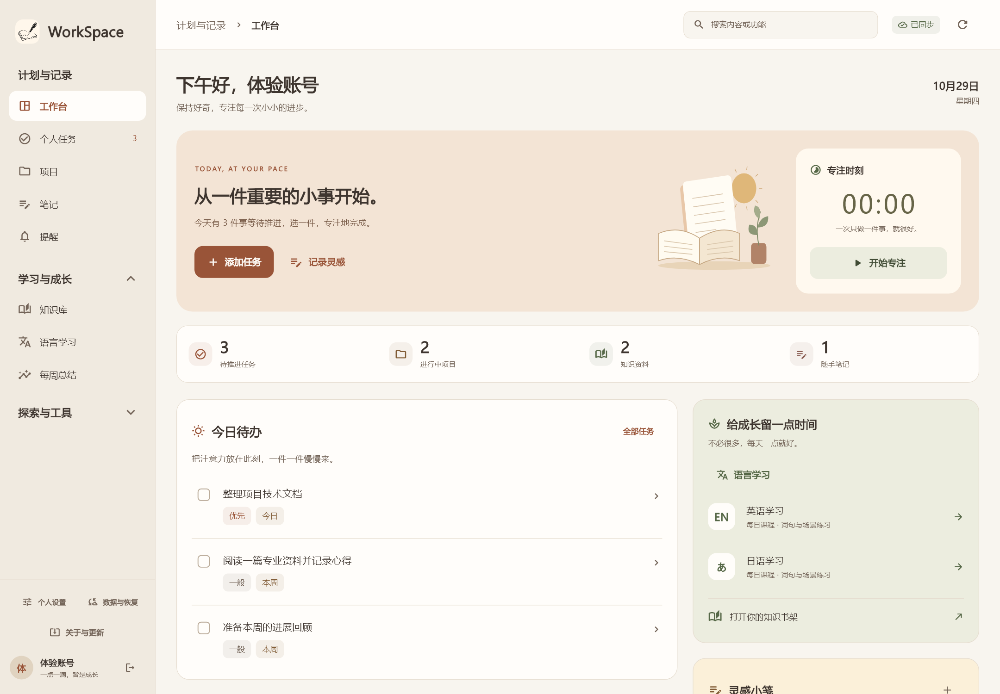

# WorkSpace · Personal Workspace

A Flutter desktop and mobile app that brings tasks, private knowledge, language learning, job applications, industry news and market research into one personal workspace.

**Windows + Android · Supabase backend · Optional bring-your-own AI API**

[中文](README.md) · [Download v0.6.0 preview](https://github.com/Z-FLY-FADED/atlas-personal-workbench/releases/tag/v0.6.0) · [Release notes](docs/release-0.6.0.md) · [Report an issue](https://github.com/Z-FLY-FADED/atlas-personal-workbench/issues/new/choose)



## Features

- Tasks, projects, notes, reminders, focus sessions and weekly reviews.
- A personal knowledge library with sources, relationships and practical guides.
- English and Japanese learning materials. The current app interface is primarily Chinese.
- Resume versions, application tracking, keyword matching and combined job filters.
- A-share, Hong Kong and US market catalogs, watchlists and quote filters; Jin10 financial news.
- Industry feeds covering AI, robotics, smart manufacturing and new energy, with source categories and publication-time filters.
- User-configured Chat Completions compatible APIs for searching personal materials, summarizing and previewing knowledge edits.
- Account-scoped server storage and an update flow with encrypted local backups.

AI is off by default. Model API keys are encrypted server-side and unavailable through client table access. Entity writes use revision checks and account isolation through Supabase Auth and RLS.

## Data sources and current limits

Collection is triggered manually. Adapters support RSS, Atom, JSON Feed, public announcements, JobPosting data, Jin10 and CCTV technology news. Login walls, verification challenges, source changes and timeouts can prevent collection.

WeChat public articles can be imported by URL when the body is publicly readable. Continuous WeChat updates require a user-authorized external feed service; this is **not connected out of the box**. Live tests encountered a verification page. Official corporate websites and WeChat accounts have separate source categories.

Job links do not confirm that a role is still open. Market filters use available quotes in their original currency. See [source details](docs/industry-sources.md) and [AI/deployment details](docs/exploration-and-ai.md) in Chinese.

## Download

Choose the complete Windows x64 ZIP or signed Android APK from [Releases](https://github.com/Z-FLY-FADED/atlas-personal-workbench/releases/tag/v0.6.0). Keep the Windows DLLs and `data/` next to `WorkSpace.exe`. Android upgrades use the same application ID and signing certificate; install over the existing app.

This is a public preview. The Windows executable has no commercial code signature. Android physical-device upgrade and live cross-device synchronization acceptance remain pending. Included screenshots use isolated test data.

## Development

The primary app lives in `apps/atlas/`. Configure your own Supabase project using `apps/atlas/config/example.json`, then apply the database migrations and deploy the Edge Functions following [the native app guide](docs/native-app.md). Only the project URL and publishable key belong in client configuration.

```powershell
powershell -ExecutionPolicy Bypass -File scripts/flutter-app.ps1 -Action get
powershell -ExecutionPolicy Bypass -File scripts/flutter-app.ps1 -Action analyze
powershell -ExecutionPolicy Bypass -File scripts/flutter-app.ps1 -Action test
powershell -ExecutionPolicy Bypass -File scripts/flutter-app.ps1 -Action run-windows -Config dev
```

The original React/Electron application remains available for migration reference. See [the legacy guide](docs/legacy-web.md). Contributions and reproducible bug reports are welcome: [Contributing](CONTRIBUTING.md).
