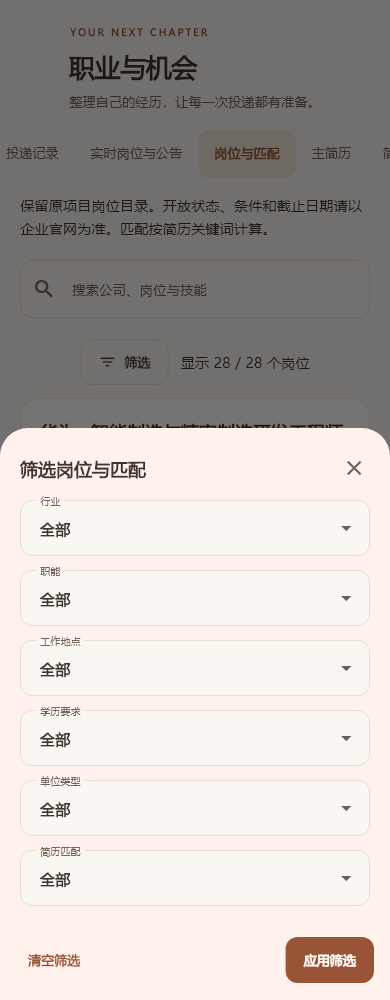
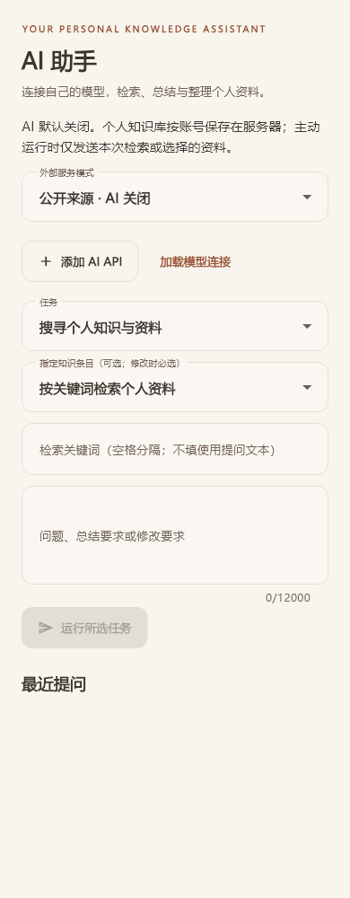
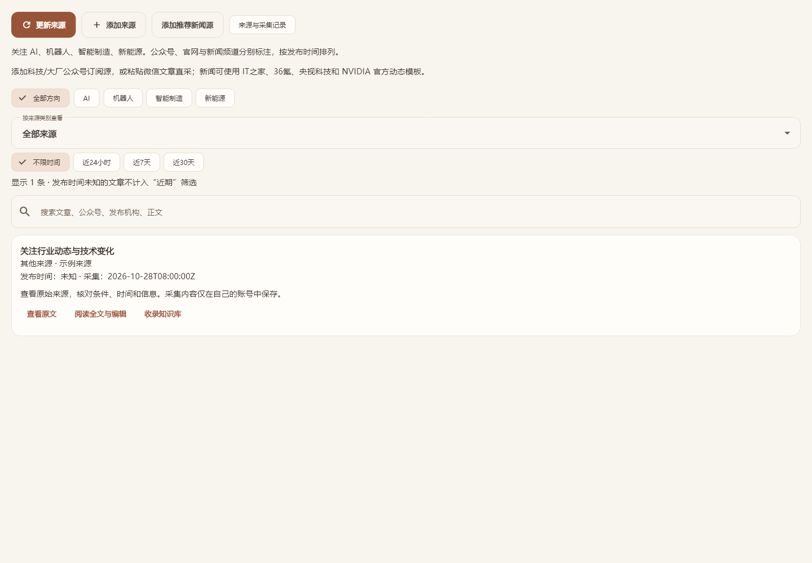

# WorkSpace · 个人工作台

把任务、知识、学习与行业信息，放进同一个属于自己的工作空间。

A personal workspace for Windows and Android: tasks, private knowledge, language learning, job tracking, market research and optional AI assistance. Built with Flutter and Supabase. [English](README.en.md)

[](https://github.com/Z-FLY-FADED/atlas-personal-workbench/releases)
[](docs/download-and-use.md)
[](apps/atlas)
[](supabase)

**[下载 0.6.0 公开测试版](https://github.com/Z-FLY-FADED/atlas-personal-workbench/releases/tag/v0.6.0)** · [使用说明](docs/download-and-use.md) · [本次更新](docs/release-0.6.0.md) · [反馈问题](https://github.com/Z-FLY-FADED/atlas-personal-workbench/issues/new/choose)


## 可以做什么

| 场景 | 功能 |
| --- | --- |
| 计划与记录 | 今日工作台、任务、项目、笔记、提醒、专注与每周总结 |
| 私人知识库 | 保存正文、来源和关联资料，阅读 Know-how 指南，将资讯沉淀成自己的知识 |
| 语言学习 | 英语与日语课程、词句和场景练习 |
| 求职管理 | 主简历、简历版本、投递记录、岗位目录与关键词匹配；组合筛选进展、公司、地点、学历等条件 |
| 股票研究 | A 股、港股、美股目录与自选分组；筛选市场、行业、风险、行情、涨跌与价格；金十财经资讯 |
| 行业速览 | 关注 AI、机器人、智能制造、新能源；区分科技公众号、大厂公众号、新闻频道、媒体与官网来源 |
| 个人 AI | 添加兼容 Chat Completions 的 API 与模型，搜索当前账号资料、总结内容、预览并确认知识正文修改 |
| 双端与更新 | Windows / Android 共用账号；服务器按账号隔离；更新前同步和创建本机加密备份 |

AI 默认关闭，公开来源采集与规则筛选无需模型。个人知识、来源和 AI 记录保存在服务器，模型 API Key 在服务端加密，客户端不能读取密钥表。数据通过 Supabase Auth、RLS 与版本检查约束，详见 [架构与部署](docs/native-app.md) 和 [探索与 AI](docs/exploration-and-ai.md)。

## 0.6.0 新增

- **筛选更细**：投递记录、岗位与匹配、股票目录及自选均支持多条件组合，保留已有搜索与快捷标签。[筛选规则](docs/list-filters.md)
- **资讯有来源**：RSS / Atom / JSON Feed、公开网页公告、JobPosting、金十和央视科技适配；记录原文、发布时间、采集结果和失败原因。
- **公众号独立分类**：支持微信单篇公开正文提取及已授权订阅源接入；按方向、类别和近期时间筛选。[来源说明](docs/industry-sources.md)
- **AI 用自己的接口**：多组 API 连接，账号内资料检索、总结与正文修改预览；确认保存时检查资料版本，避免覆盖其他设备的新修改。

采集由用户点击“更新来源”触发，目前没有后台定时采集。网站登录、验证码、反爬和服务超时会影响可用性。公众号单篇链接不会自动发现新文章；持续更新需要接入自己授权的订阅服务。微信实测返回验证页时会记为失败，**尚未接通公众号最新推文的持续采集**。招聘来源入口不代表已经核实岗位开放状态，股票价格按原币展示。

## 界面预览

截图使用隔离测试数据，展示桌面和手机布局。

| 岗位组合筛选 | 个人 AI 接口与资料操作 |
| --- | --- |
|  |  |



## 下载与开始使用

在 [Releases](https://github.com/Z-FLY-FADED/atlas-personal-workbench/releases/tag/v0.6.0) 的 Assets 中选择安装包，普通使用者无需编译源码。

| 平台 | 下载与运行 |
| --- | --- |
| Windows 10 / 11 x64 | [完整 ZIP](https://github.com/Z-FLY-FADED/atlas-personal-workbench/releases/download/v0.6.0/WorkSpace-0.6.0-Windows-x64.zip)，解压后运行 `WorkSpace.exe`，保留 DLL 和 `data/` |
| Android | [签名 APK](https://github.com/Z-FLY-FADED/atlas-personal-workbench/releases/download/v0.6.0/WorkSpace-0.6.0-Android.apk)，通过系统安装流程安装；升级时覆盖安装 |

首次注册自己的用户名与密码；在两个设备登录同一账号即可访问同一云端工作区。注册、登录和服务器保存需要联网。公开安装包连接维护者托管的 Supabase 项目，自部署可以配置自己的项目。已有 0.5.2 用户可在“关于与更新”中检查新版；更新会先同步并创建本机加密备份，仍建议保留独立导出。[更新与数据保护](docs/app-updates.md)

当前为公开测试版：Windows 未做商业代码签名，Android 真机覆盖安装和双设备同步尚未完成实测。发布页附文件校验清单。详细范围见 [0.6.0 更新说明](docs/release-0.6.0.md)。

## 从源码运行

主应用使用 Flutter / Dart，服务端为 Supabase PostgreSQL、Realtime 与 Edge Functions。准备 Flutter 和对应平台工具链，将 `apps/atlas/config/example.json` 复制为同目录下的 `dev.json`，填写自己的 Supabase URL 与 **Publishable Key**。数据库迁移、函数和服务端密钥配置见 [双端应用说明](docs/native-app.md) 及 [探索与 AI 部署](docs/exploration-and-ai.md)。

```powershell
powershell -ExecutionPolicy Bypass -File scripts/flutter-app.ps1 -Action get
powershell -ExecutionPolicy Bypass -File scripts/flutter-app.ps1 -Action analyze
powershell -ExecutionPolicy Bypass -File scripts/flutter-app.ps1 -Action test
powershell -ExecutionPolicy Bypass -File scripts/flutter-app.ps1 -Action run-windows -Config dev
```

Android 运行使用 `-Action run-android -Device <设备编号>`。发布构建使用 `-Action build-windows -Config prod` 和 `-Action build-apk -Config prod`，APK 需要本机长期签名。不要将服务端密钥、模型 API Key、签名文件或个人数据提交到仓库。

```text
apps/atlas/        Flutter Windows / Android 主应用
supabase/         数据库迁移、账号隔离规则、采集与 AI 函数、服务端测试
scripts/          开发、构建、签名校验与公开更新清单工具
updates/          已安装用户读取的公开版本清单
docs/             使用、部署、版本说明与界面截图
app/ + desktop/   保留的 React / Electron 旧应用
```

旧版开发命令与 D1 架构保留在 [旧版工作台说明](docs/legacy-web.md)。

## 参与与反馈

欢迎通过 [Issues](https://github.com/Z-FLY-FADED/atlas-personal-workbench/issues) 提交问题和具体使用场景，或阅读 [贡献指南](CONTRIBUTING.md) 后提交 PR。反馈时请附版本、平台和复现步骤，并移除个人资料与密钥。如果项目对你有帮助，欢迎 Star 或分享项目链接。

设计参考 [RSSHub](https://github.com/DIYgod/RSSHub)、[Scrapy](https://github.com/scrapy/scrapy)、[AKShare](https://github.com/akfamily/akshare) 和 [Dify](https://github.com/langgenius/dify) 的来源适配与检索组织方式；本仓库自行实现轻量流程。公众号授权订阅可对接 [WeWe RSS](https://github.com/cooderl/wewe-rss) 等独立服务，未将这些平台打包进客户端。
